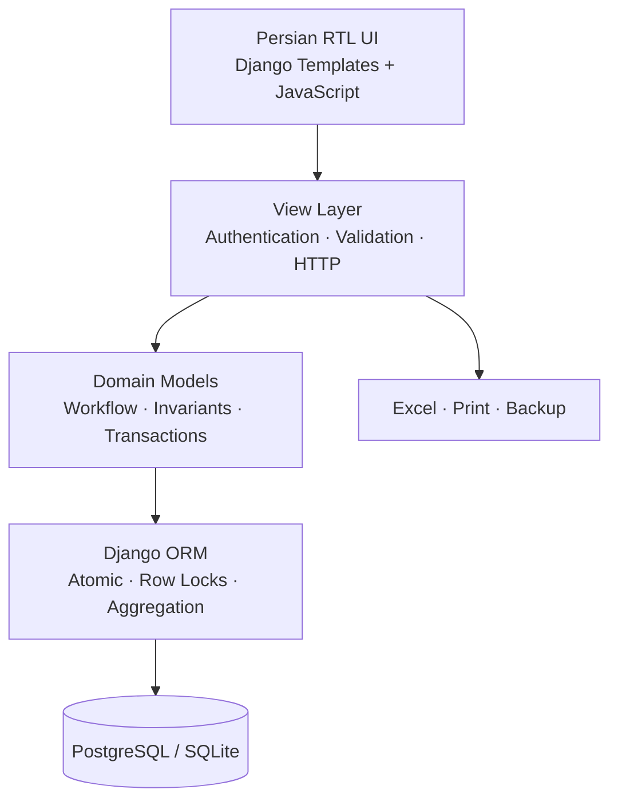

# Smart Inventory — Professional Warehouse & Inventory Control System

[نسخه فارسی](README.md)

Smart Inventory is an integrated web-based warehouse management system covering purchasing, sales commitments, receipts and issues, perpetual inventory, cycle counting, controlled adjustments, returns, batch tracking, and management reporting.

**Developer:** Melina Maghferat  
**My role:** End-to-end domain analysis and full-stack implementation, including data modeling, transactional inventory logic, document workflows, access control, reporting, Persian RTL UI, and production configuration.

> This is a portfolio/showcase repository. The complete operational source, real data, environment configuration, and proprietary assets are intentionally withheld. Files under [`examples/`](examples/README.md) are selected excerpts from the real implementation—not synthetic demo code.

## Core engineering work

| Area | Implementation |
|---|---|
| Inventory engine | On-hand, reserved, allocated, and available stock; negative-stock prevention; deterministic row locking |
| Sales workflow | Proforma → Order → Approved → Shipped → Delivered → Settled with atomic commitment transfers |
| Purchasing | Purchase invoices, warehouse receipts, exact line matching, and receipt-driven status transitions |
| Warehouse documents | Receipts, issues, positive/negative adjustments, purchase returns, and sales returns |
| Perpetual inventory | Quantity delta, resulting balance, timestamp, and exactly one source for every Kardex entry |
| Stock counting | Opening snapshot, barcode scans, discrepancy calculation, and controlled adjustment generation |
| Traceability | SKU, barcode, group, brand, unit, physical attributes, image, batch, serial, production, and expiry |
| Reporting | Sellable inventory, movement, stagnant/slow items, stock health, open discrepancies, and multi-sheet Excel |
| Security | Django authentication, group/permission RBAC, API-aware 403 responses, and protected admin operations |
| Deployment | Split development/production settings, environment-driven secrets, PostgreSQL, secure cookies, HSTS, and CSRF configuration |

## Architecture

## Selected real implementation excerpts

- [Atomic inventory engine](examples/domain/inventory_engine.py)
- [Sales inventory commitments](examples/domain/sales_commitment.py)
- [Warehouse document posting](examples/domain/warehouse_posting.py)
- [Inventory count snapshots](examples/domain/inventory_counting.py)
- [Role-based access control](examples/security/rbac.py)
- [End-to-end workflow test](examples/tests/test_inventory_workflow.py)

## Project footprint

- 15 core domain models/entities
- 53 web and operational routes
- 12 database migrations
- 28 responsive Persian templates
- 5,300+ lines of Python and 7,300+ lines of templates
- 22 security, inventory stability, workflow, and reporting tests

## Documentation

- [Architecture](docs/ARCHITECTURE.md)
- [Feature map](docs/FEATURES.md)
- [Domain and data model](docs/DATA_MODEL.md)
- [Technical deep dive](docs/TECHNICAL_DEEP_DIVE.md)
- [Public repository boundary](NOTICE.md)

## License

This is not an open-source project. The selected excerpts are published solely for technical evaluation and portfolio presentation. See [LICENSE.md](LICENSE.md).

