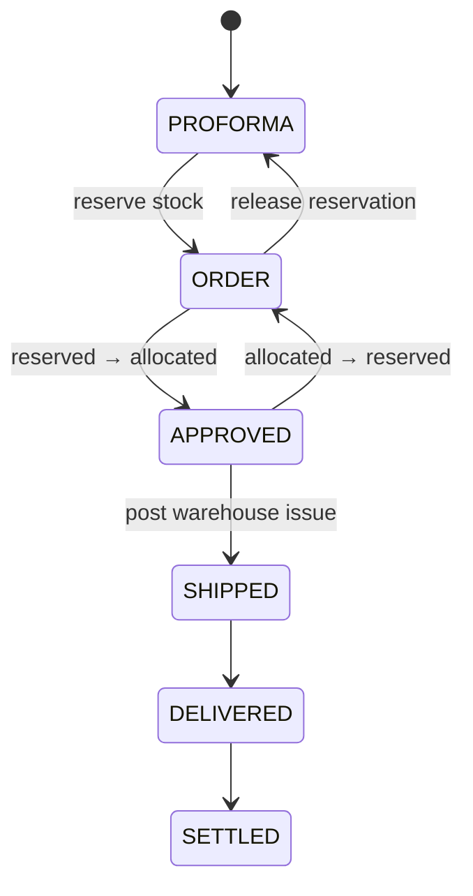
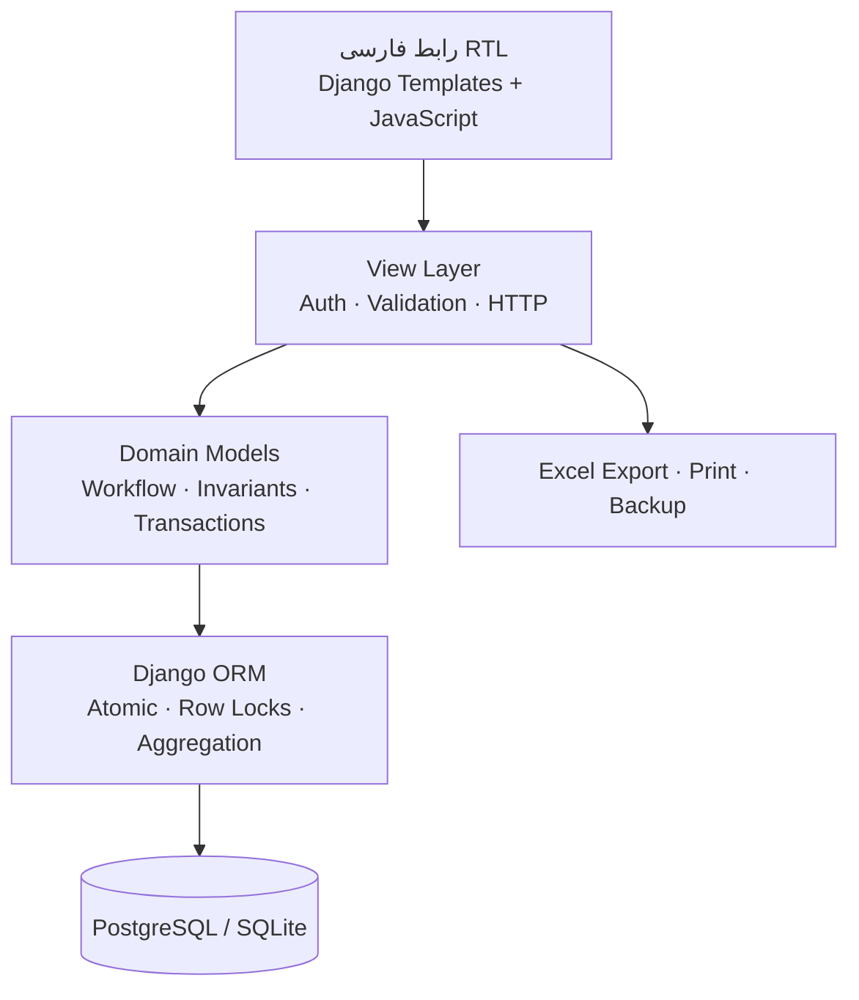

# Smart Inventory — سامانه حرفه‌ای مدیریت انبار و کنترل موجودی

[English version](README.en.md)

Smart Inventory یک سامانه وب یکپارچه برای مدیریت عملیات انبار است که جریان خرید، فروش، رزرو و تخصیص موجودی، رسید و حواله، کاردکس، انبارگردانی، تعدیل، برگشت کالا، رهگیری بچ و گزارش‌های مدیریتی را در یک مدل دامنه منسجم به هم متصل می‌کند.

**توسعه‌دهنده:** ملینا مغفرت  
**نقش من در پروژه:** تحلیل دامنه و توسعه Full-Stack شامل مدل‌سازی داده، منطق تراکنشی موجودی، گردش‌کار اسناد، کنترل دسترسی، گزارش‌گیری، رابط فارسی RTL و تنظیمات استقرار.

> این ریپازیتوری نسخه Portfolio/Showcase پروژه است. سورس عملیاتی کامل، داده‌های واقعی، تنظیمات محیط و دارایی‌های اختصاصی عمداً منتشر نشده‌اند. فایل‌های پوشه [`examples/`](examples/README.md) برش‌های واقعی و منتخب از پیاده‌سازی اصلی هستند، نه کد نمایشی ساختگی.

## مسئله‌ای که سیستم حل می‌کند

در یک انبار عملیاتی، «موجودی» فقط یک عدد نیست. سفارش فروش می‌تواند بخشی از کالا را رزرو و سپس تخصیص دهد؛ رسید و حواله باید موجودی و کاردکس را اتمیک به‌روزرسانی کنند؛ برگشت نباید از مقدار سند مرجع بیشتر شود؛ و تعدیل انبارگردانی باید دقیقاً با اختلاف شمارش فیزیکی منطبق باشد.

Smart Inventory این قواعد را در یک جریان کنترل‌شده پیاده‌سازی می‌کند:

## بخش‌هایی که پیاده‌سازی کردم

<table dir="rtl">
  <thead>
    <tr>
      <th align="right" dir="rtl">حوزه</th>
      <th align="right" dir="rtl">پیاده‌سازی انجام‌شده</th>
    </tr>
  </thead>
  <tbody>
    <tr><td align="right" dir="rtl">موتور موجودی</td><td align="right" dir="rtl">موجودی فیزیکی، رزروشده، تخصیص‌یافته و قابل‌فروش؛ جلوگیری از مانده منفی؛ قفل سطری با <code>select_for_update</code></td></tr>
    <tr><td align="right" dir="rtl">فروش</td><td align="right" dir="rtl">گردش وضعیت پیش‌فاکتور ← سفارش ← تأیید ← ارسال ← تحویل ← تسویه و انتقال اتمیک تعهد موجودی</td></tr>
    <tr><td align="right" dir="rtl">خرید</td><td align="right" dir="rtl">ثبت فاکتور خرید، صدور رسید انبار، کنترل تطابق اقلام و تغییر وضعیت پس از دریافت</td></tr>
    <tr><td align="right" dir="rtl">اسناد انبار</td><td align="right" dir="rtl">رسید، حواله، تعدیل افزایشی/کاهشی، برگشت خرید و برگشت فروش با <code>Draft / Post / Cancel</code></td></tr>
    <tr><td align="right" dir="rtl">کاردکس</td><td align="right" dir="rtl">ثبت تغییر موجودی، مانده بعد از هر تراکنش و اتصال هر ردیف به دقیقاً یک سند مرجع</td></tr>
    <tr><td align="right" dir="rtl">انبارگردانی</td><td align="right" dir="rtl">ثبت Snapshot موجودی ابتدای شمارش، اسکن بارکد، محاسبه کسری/اضافی و تولید سند تعدیل منطبق با مغایرت</td></tr>
    <tr><td align="right" dir="rtl">رهگیری کالا</td><td align="right" dir="rtl">کد و بارکد، گروه، برند، واحد، وزن، حجم، ابعاد، تصویر، مشخصات فنی، بچ، سریال، تولید و انقضا</td></tr>
    <tr><td align="right" dir="rtl">گزارش مدیریتی</td><td align="right" dir="rtl">موجودی قابل‌فروش، کالای راکد و کم‌گردش، سلامت موجودی، گردش کالا، KPI و مغایرت‌های باز</td></tr>
    <tr><td align="right" dir="rtl">Excel</td><td align="right" dir="rtl">خروجی چندبرگی برای Summary، گردش، کالاهای راکد، مغایرت‌ها، کاردکس و اسناد انبار</td></tr>
    <tr><td align="right" dir="rtl">امنیت</td><td align="right" dir="rtl">احراز هویت Django، کنترل دسترسی مبتنی بر Group / Permission و RBAC، پاسخ 403 برای API و محدودسازی عملیات حساس</td></tr>
    <tr><td align="right" dir="rtl">استقرار</td><td align="right" dir="rtl">Settings مجزای Development / Production، متغیرهای محیطی، PostgreSQL، Secure Cookie، HSTS و CSRF Trusted Origins</td></tr>
    <tr><td align="right" dir="rtl">تجربه کاربری</td><td align="right" dir="rtl">رابط فارسی RTL، طراحی Responsive، فرم‌های عملیاتی، چاپ رسمی اسناد و Date Picker شمسی</td></tr>
  </tbody>
</table>

## قواعد مهم دامنه

<ul dir="rtl">
  <li align="right"><code>available_stock = stock - reserved_stock - allocated_stock</code></li>
  <li align="right">ثبت نهایی سند در یک تراکنش دیتابیس انجام می‌شود.</li>
  <li align="right">محصولات در عملیات حساس به ترتیب ثابت قفل می‌شوند تا ریسک Race Condition و Deadlock کاهش یابد.</li>
  <li align="right">رسید/حواله وابسته به فاکتور باید دقیقاً با اقلام سند مرجع منطبق باشد.</li>
  <li align="right">مجموع برگشت‌های ثبت‌شده نمی‌تواند از مقدار خرید یا فروش مرجع بیشتر شود.</li>
  <li align="right">سند تعدیل انبارگردانی فقط زمانی معتبر است که اقلام آن دقیقاً برابر کسری یا اضافی Snapshot باشند.</li>
  <li align="right">هر ردیف کاردکس دقیقاً یک منشأ دارد: سند انبار یا تراکنش دستی.</li>
</ul>

## معماری

جزئیات بیشتر در [مستند معماری](docs/ARCHITECTURE.md) و [شرح فنی](docs/TECHNICAL_DEEP_DIVE.md) آمده است.

## بخش‌های منتخب پیاده‌سازی

<table dir="rtl">
  <thead>
    <tr>
      <th align="right" dir="rtl">نمونه</th>
      <th align="right" dir="rtl">رفتار فنی قابل بررسی</th>
    </tr>
  </thead>
  <tbody>
    <tr><td align="right" dir="rtl"><a href="examples/domain/inventory_engine.py">Inventory Engine</a></td><td align="right" dir="rtl">قفل سطری، کنترل invariantها، تغییر اتمیک مانده و تولید کاردکس</td></tr>
    <tr><td align="right" dir="rtl"><a href="examples/domain/sales_commitment.py">Sales Commitment</a></td><td align="right" dir="rtl">انتقال موجودی بین bucketهای رزرو و تخصیص در گردش وضعیت فروش</td></tr>
    <tr><td align="right" dir="rtl"><a href="examples/domain/warehouse_posting.py">Warehouse Posting</a></td><td align="right" dir="rtl">اعتبارسنجی سند مرجع، برگشت، انبارگردانی و ثبت نهایی سند</td></tr>
    <tr><td align="right" dir="rtl"><a href="examples/domain/inventory_counting.py">Inventory Count</a></td><td align="right" dir="rtl">Snapshot شمارش و جلوگیری از اسکن خارج از جلسه باز</td></tr>
    <tr><td align="right" dir="rtl"><a href="examples/security/rbac.py">RBAC</a></td><td align="right" dir="rtl">ترکیب Group، Permission، نقش و پاسخ مناسب HTML / JSON</td></tr>
    <tr><td align="right" dir="rtl"><a href="examples/tests/test_inventory_workflow.py">Workflow Test</a></td><td align="right" dir="rtl">تست End-to-End رزرو، تخصیص، حواله، خروج موجودی و کاردکس</td></tr>
  </tbody>
</table>

این فایل‌ها عمداً standalone نیستند؛ آن‌ها excerptهای واقعی از ماژول‌های اصلی‌اند و مرزهای مالکیت سورس را حفظ می‌کنند.

## شاخص‌های پروژه

<ul dir="rtl">
  <li align="right">۱۵ مدل و موجودیت دامنه‌ای اصلی</li>
  <li align="right">۵۳ مسیر وب و عملیاتی</li>
  <li align="right">۱۲ migration تکاملی دیتابیس</li>
  <li align="right">۲۸ Template فارسی و Responsive</li>
  <li align="right">بیش از ۵٬۳۰۰ خط Python و ۷٬۳۰۰ خط Template</li>
  <li align="right">۲۲ تست امنیت، پایداری موجودی، Workflow و گزارش‌گیری</li>
</ul>

اعداد بالا از نسخه محلی پروژه در زمان آماده‌سازی این Showcase استخراج شده‌اند. جزئیات دامنه در [فهرست قابلیت‌ها](docs/FEATURES.md) قابل مشاهده است.

## چالش‌های فنی و راه‌حل‌ها

<table dir="rtl">
  <thead>
    <tr>
      <th align="right" dir="rtl">چالش</th>
      <th align="right" dir="rtl">راه‌حل پیاده‌سازی‌شده</th>
    </tr>
  </thead>
  <tbody>
    <tr><td align="right" dir="rtl">جلوگیری از Overselling</td><td align="right" dir="rtl">تفکیک stock / reserved / allocated و کنترل available stock داخل تراکنش</td></tr>
    <tr><td align="right" dir="rtl">هم‌زمانی چند اپراتور</td><td align="right" dir="rtl"><code>transaction.atomic</code>، <code>select_for_update</code> و ترتیب قطعی قفل محصولات</td></tr>
    <tr><td align="right" dir="rtl">هماهنگی فروش و انبار</td><td align="right" dir="rtl">تبدیل وضعیت سفارش به تعهد موجودی و آزادسازی تخصیص هنگام ثبت حواله</td></tr>
    <tr><td align="right" dir="rtl">صحت برگشت کالا</td><td align="right" dir="rtl">محاسبه مجموع برگشت‌های قبلی و کنترل سقف باقی‌مانده سند مرجع</td></tr>
    <tr><td align="right" dir="rtl">مغایرت شمارش</td><td align="right" dir="rtl">Snapshot مستقل از تغییرات بعدی و الزام تطابق کامل سند تعدیل با اختلاف</td></tr>
    <tr><td align="right" dir="rtl">گزارش قابل تصمیم‌گیری</td><td align="right" dir="rtl">طبقه‌بندی Active / Slow / Stagnant، سلامت موجودی و خروجی Excel چندبرگی</td></tr>
    <tr><td align="right" dir="rtl">تفکیک سطح دسترسی</td><td align="right" dir="rtl">Decorator مشترک برای Permission / Role با رفتار متفاوت برای HTML و JSON</td></tr>
    <tr><td align="right" dir="rtl">آماده‌سازی Production</td><td align="right" dir="rtl">جداسازی Settings و انتقال Secret، DB و Security Flags به Environment</td></tr>
  </tbody>
</table>

## تکنولوژی‌ها

`Python` · `Django` · `Django ORM` · `PostgreSQL` · `SQLite` · `HTML5` · `CSS3` · `JavaScript` · `OpenPyXL` · `Pillow` · `Responsive RTL UI`

## مستندات

<ul dir="rtl">
  <li align="right"><a href="docs/ARCHITECTURE.md">معماری سیستم</a></li>
  <li align="right"><a href="docs/FEATURES.md">فهرست قابلیت‌ها</a></li>
  <li align="right"><a href="docs/DATA_MODEL.md">مدل دامنه و داده</a></li>
  <li align="right"><a href="docs/TECHNICAL_DEEP_DIVE.md">شرح فنی پیاده‌سازی</a></li>
  <li align="right"><a href="examples/README.md">راهنمای نمونه‌کدها</a></li>
  <li align="right"><a href="NOTICE.md">مرز نسخه عمومی</a></li>
</ul>

## مجوز و مالکیت

این پروژه Open Source نیست. کدهای منتخب فقط برای ارزیابی فنی و نمایش در Portfolio منتشر شده‌اند. شرایط دقیق در [LICENSE.md](LICENSE.md) آمده است.

