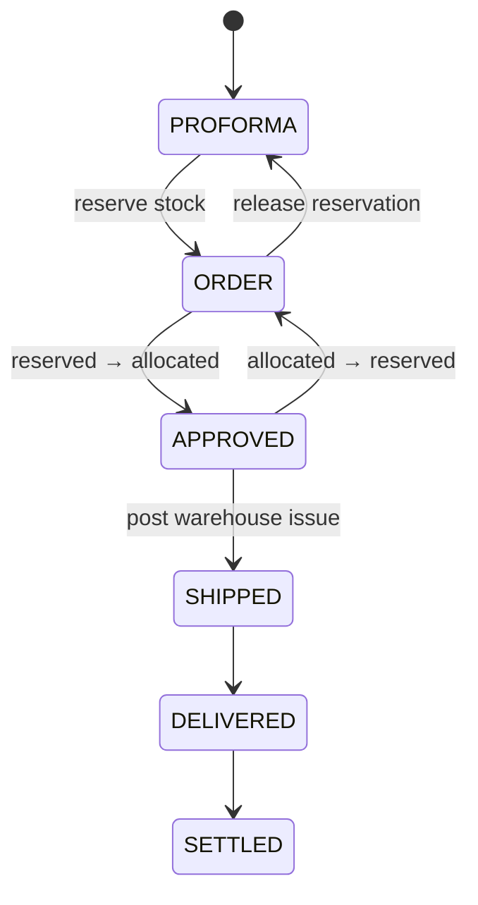
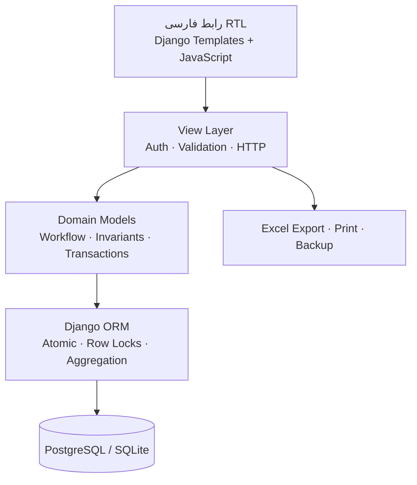

# Smart Inventory — سامانه حرفه‌ای مدیریت انبار و کنترل موجودی

[English version](README.en.md)

Smart Inventory یک سامانه وب یکپارچه برای مدیریت عملیات انبار است که جریان خرید، فروش، رزرو و تخصیص موجودی، رسید و حواله، کاردکس، انبارگردانی، تعدیل، برگشت کالا، رهگیری بچ و گزارش‌های مدیریتی را در یک مدل دامنه منسجم به هم متصل می‌کند.

**توسعه‌دهنده:** ملینا مغفرت  
**نقش من در پروژه:** تحلیل دامنه و توسعه Full-Stack شامل مدل‌سازی داده، منطق تراکنشی موجودی، گردش‌کار اسناد، کنترل دسترسی، گزارش‌گیری، رابط فارسی RTL و تنظیمات استقرار.

> این ریپازیتوری نسخه Portfolio/Showcase پروژه است. سورس عملیاتی کامل، داده‌های واقعی، تنظیمات محیط و دارایی‌های اختصاصی عمداً منتشر نشده‌اند. فایل‌های پوشه [`examples/`](examples/README.md) برش‌های واقعی و منتخب از پیاده‌سازی اصلی هستند، نه کد نمایشی ساختگی.

## مسئله‌ای که سیستم حل می‌کند

در یک انبار عملیاتی، «موجودی» فقط یک عدد نیست. سفارش فروش می‌تواند بخشی از کالا را رزرو و سپس تخصیص دهد؛ رسید و حواله باید موجودی و کاردکس را اتمیک به‌روزرسانی کنند؛ برگشت نباید از مقدار سند مرجع بیشتر شود؛ و تعدیل انبارگردانی باید دقیقاً با اختلاف شمارش فیزیکی منطبق باشد.

Smart Inventory این قواعد را در یک جریان کنترل‌شده پیاده‌سازی می‌کند:

## بخش‌هایی که پیاده‌سازی کردم

| حوزه | پیاده‌سازی انجام‌شده |
|---|---|
| موتور موجودی | موجودی فیزیکی، رزروشده، تخصیص‌یافته و قابل‌فروش؛ جلوگیری از مانده منفی؛ قفل سطری با `select_for_update` |
| فروش | گردش وضعیت پیش‌فاکتور → سفارش → تأیید → ارسال → تحویل → تسویه و انتقال اتمیک تعهد موجودی |
| خرید | ثبت فاکتور خرید، صدور رسید انبار، کنترل تطابق اقلام و تغییر وضعیت پس از دریافت |
| اسناد انبار | رسید، حواله، تعدیل افزایشی/کاهشی، برگشت خرید و برگشت فروش با Draft/Post/Cancel |
| کاردکس | ثبت تغییر موجودی، مانده بعد از هر تراکنش و اتصال هر ردیف به دقیقاً یک سند مرجع |
| انبارگردانی | Snapshot موجودی ابتدای شمارش، اسکن بارکد، محاسبه کسری/اضافی و تولید سند تعدیل منطبق با مغایرت |
| رهگیری کالا | کد و بارکد، گروه، برند، واحد، وزن، حجم، ابعاد، تصویر، مشخصات فنی، بچ، سریال، تولید و انقضا |
| گزارش مدیریتی | KPI موجودی قابل‌فروش، کالای راکد و کم‌گردش، سلامت موجودی، گردش کالا و مغایرت‌های باز |
| Excel | خروجی چندبرگی برای Summary، گردش، کالاهای راکد، مغایرت‌ها، کاردکس و اسناد انبار |
| امنیت | احراز هویت Django، RBAC مبتنی بر Group/Permission، پاسخ 403 برای API و محدودسازی عملیات حساس |
| استقرار | Settings مجزای Development/Production، متغیرهای محیطی، PostgreSQL، Secure Cookie، HSTS و CSRF Trusted Origins |
| تجربه کاربری | رابط فارسی RTL، طراحی Responsive، فرم‌های عملیاتی، چاپ رسمی اسناد و Date Picker شمسی |

## قواعد مهم دامنه

- `available_stock = stock - reserved_stock - allocated_stock`
- ثبت نهایی سند در یک تراکنش دیتابیس انجام می‌شود.
- محصولات در عملیات حساس به ترتیب ثابت قفل می‌شوند تا ریسک Race Condition و Deadlock کاهش یابد.
- رسید/حواله وابسته به فاکتور باید دقیقاً با اقلام سند مرجع منطبق باشد.
- مجموع برگشت‌های ثبت‌شده نمی‌تواند از مقدار خرید یا فروش مرجع بیشتر شود.
- سند تعدیل انبارگردانی فقط زمانی معتبر است که اقلام آن دقیقاً برابر کسری یا اضافی Snapshot باشند.
- هر ردیف کاردکس دقیقاً یک منشأ دارد: سند انبار یا تراکنش دستی.

## معماری

جزئیات بیشتر در [مستند معماری](docs/ARCHITECTURE.md) و [شرح فنی](docs/TECHNICAL_DEEP_DIVE.md) آمده است.

## بخش‌های منتخب پیاده‌سازی

| نمونه | رفتار فنی قابل بررسی |
|---|---|
| [Inventory Engine](examples/domain/inventory_engine.py) | قفل سطری، کنترل invariantها، تغییر اتمیک مانده و تولید کاردکس |
| [Sales Commitment](examples/domain/sales_commitment.py) | انتقال موجودی بین bucketهای رزرو و تخصیص در گردش وضعیت فروش |
| [Warehouse Posting](examples/domain/warehouse_posting.py) | اعتبارسنجی سند مرجع، برگشت، انبارگردانی و ثبت نهایی سند |
| [Inventory Count](examples/domain/inventory_counting.py) | Snapshot شمارش و جلوگیری از اسکن خارج از جلسه باز |
| [RBAC](examples/security/rbac.py) | ترکیب Group، Permission، نقش و پاسخ مناسب HTML/JSON |
| [Workflow Test](examples/tests/test_inventory_workflow.py) | تست End-to-End رزرو، تخصیص، حواله، خروج موجودی و کاردکس |

این فایل‌ها عمداً standalone نیستند؛ آن‌ها excerptهای واقعی از ماژول‌های اصلی‌اند و مرزهای مالکیت سورس را حفظ می‌کنند.

## شاخص‌های پروژه

- ۱۵ مدل و موجودیت دامنه‌ای اصلی
- ۵۳ مسیر وب و عملیاتی
- ۱۲ migration تکاملی دیتابیس
- ۲۸ Template فارسی و Responsive
- بیش از ۵٬۳۰۰ خط Python و ۷٬۳۰۰ خط Template
- ۲۲ تست امنیت، پایداری موجودی، Workflow و گزارش‌گیری

اعداد بالا از نسخه محلی پروژه در زمان آماده‌سازی این Showcase استخراج شده‌اند. جزئیات دامنه در [فهرست قابلیت‌ها](docs/FEATURES.md) قابل مشاهده است.

## چالش‌های فنی و راه‌حل‌ها

| چالش | راه‌حل پیاده‌سازی‌شده |
|---|---|
| جلوگیری از Overselling | تفکیک stock/reserved/allocated و کنترل available stock داخل تراکنش |
| هم‌زمانی چند اپراتور | `transaction.atomic`، `select_for_update` و ترتیب قطعی قفل محصولات |
| هماهنگی فروش و انبار | تبدیل وضعیت سفارش به تعهد موجودی و آزادسازی تخصیص هنگام ثبت حواله |
| صحت برگشت کالا | محاسبه مجموع برگشت‌های قبلی و کنترل سقف باقی‌مانده سند مرجع |
| مغایرت شمارش | Snapshot مستقل از تغییرات بعدی و الزام تطابق کامل سند تعدیل با اختلاف |
| گزارش قابل تصمیم‌گیری | طبقه‌بندی Active/Slow/Stagnant، سلامت موجودی و خروجی Excel چندبرگی |
| تفکیک سطح دسترسی | Decorator مشترک برای Permission/Role با رفتار متفاوت برای HTML و JSON |
| آماده‌سازی Production | جداسازی Settings و انتقال Secret، DB و Security Flags به Environment |

## تکنولوژی‌ها

`Python` · `Django` · `Django ORM` · `PostgreSQL` · `SQLite` · `HTML5` · `CSS3` · `JavaScript` · `OpenPyXL` · `Pillow` · `Responsive RTL UI`

## مستندات

- [معماری سیستم](docs/ARCHITECTURE.md)
- [فهرست قابلیت‌ها](docs/FEATURES.md)
- [مدل دامنه و داده](docs/DATA_MODEL.md)
- [شرح فنی پیاده‌سازی](docs/TECHNICAL_DEEP_DIVE.md)
- [راهنمای نمونه‌کدها](examples/README.md)
- [مرز نسخه عمومی](NOTICE.md)

## مجوز و مالکیت

این پروژه Open Source نیست. کدهای منتخب فقط برای ارزیابی فنی و نمایش در Portfolio منتشر شده‌اند. شرایط دقیق در [LICENSE.md](LICENSE.md) آمده است.

