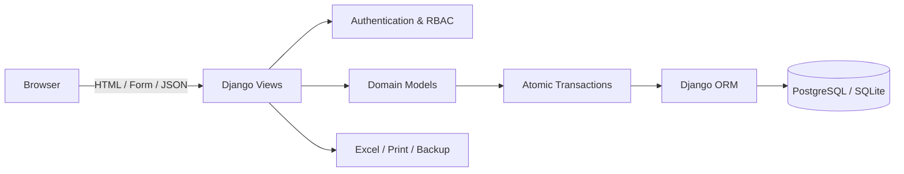
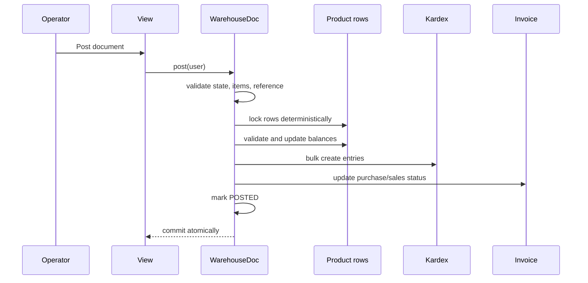

# معماری Smart Inventory

## رویکرد کلی

سیستم با معماری Monolith ماژولار Django توسعه داده شده است. این انتخاب برای یک سامانه عملیاتی انبار، مرز تراکنشی روشن و استقرار ساده ایجاد می‌کند و اجازه می‌دهد قواعد موجودی در نزدیکی مدل دامنه و دیتابیس اجرا شوند.

## لایه‌ها

### رابط کاربری

- Templateهای Django با زبان فارسی و جهت RTL
- طراحی Responsive برای دسکتاپ و موبایل
- فرم‌های مدیریت کالا، طرف حساب، فاکتور، اسناد و شمارش
- JavaScript سبک برای اسکن، فیلتر جدول، تعامل فرم و Date Picker شمسی
- صفحات چاپ رسمی برای اسناد انبار

### لایه HTTP

- Viewهای محافظت‌شده با `login_required`
- کنترل Permission و Role با decorator مشترک
- پاسخ HTML یا JSON متناسب با نوع درخواست
- اعتبارسنجی ورودی و تبدیل خطاهای دامنه به پیام قابل فهم
- فیلتر تاریخ، پروژه، وضعیت گردش و سلامت موجودی

### مدل دامنه

منطق حساس در مدل‌های دامنه قرار گرفته است تا از هر مسیر ورودی—فرم، View یا عملیات داخلی—قواعد یکسان اجرا شوند:

- انتقال وضعیت سفارش فروش
- رزرو و تخصیص موجودی
- صدور رسید و حواله از سند تجاری
- ثبت نهایی سند انبار
- اعتبارسنجی برگشت و تعدیل
- ساخت Snapshot انبارگردانی
- ثبت کاردکس و مانده جدید

### Persistence و تراکنش

- `transaction.atomic` برای عملیات چندمرحله‌ای
- `select_for_update` برای قفل سطری سفارش و کالا
- مرتب‌سازی شناسه محصولات پیش از قفل برای رفتار قطعی
- `bulk_create` برای Snapshot، اقلام سند و کاردکس
- Aggregateهای دیتابیس برای جمع برگشت‌ها و شمارش‌ها

## مرز تراکنش ثبت سند

اگر هر اعتبارسنجی یا تغییر موجودی شکست بخورد، کل عملیات Rollback می‌شود و سند نیمه‌ثبت‌شده یا کاردکس ناسازگار باقی نمی‌ماند.

## تنظیمات محیط

Settings به سه بخش تقسیم شده است:

- `base`: تنظیمات مشترک، Middleware، Template، Database و Security defaults
- `development`: Debug و تنظیمات مناسب توسعه محلی
- `production`: Debug خاموش و Hostهای مجاز از Environment

Secret Key، اتصال دیتابیس، Allowed Hosts، CSRF Origins، Secure Cookie و HSTS از متغیرهای محیطی دریافت می‌شوند.

