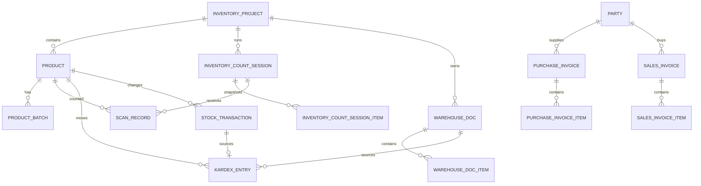

# مدل دامنه و داده

## موجودیت‌های اصلی



## موجودی به‌عنوان چند مقدار مستقل

مدل `Product` چهار مفهوم جدا را نگهداری یا محاسبه می‌کند:

| مقدار | معنا |
|---|---|
| `stock` | موجودی فیزیکی ثبت‌شده در انبار |
| `reserved_stock` | موجودی متعهد به سفارش ثبت‌شده |
| `allocated_stock` | موجودی تخصیص‌یافته به سفارش تأییدشده |
| `available_stock` | موجودی آزاد قابل فروش |

رابطه اصلی:

```text
available_stock = stock - reserved_stock - allocated_stock
```

Invariantهای دامنه اجازه منفی‌شدن هیچ‌کدام از مانده‌های معتبر را نمی‌دهند.

## منشأ کاردکس

هر `KardexEntry` باید دقیقاً یکی از این دو مرجع را داشته باشد:

1. `warehouse_doc` برای رسید، حواله، برگشت یا تعدیل؛
2. `stock_transaction` برای تراکنش دستی کنترل‌شده.

این Constraint منطقی، Audit Trail را شفاف نگه می‌دارد و از حرکت موجودی بدون منشأ جلوگیری می‌کند.

## Snapshot انبارگردانی

در شروع Session، موجودی همان لحظه هر کالا در `InventoryCountSessionItem.expected_stock` ذخیره می‌شود. بنابراین تغییرات بعدی موجودی، مبنای شمارش آغازشده را جابه‌جا نمی‌کند. اختلاف از رابطه زیر به‌دست می‌آید:

```text
difference = total_scanned - expected_stock
```

سند تعدیل فقط وقتی قابل Post است که مجموعه اقلام و مقادیر آن دقیقاً با کسری یا اضافی محاسبه‌شده برابر باشد.

